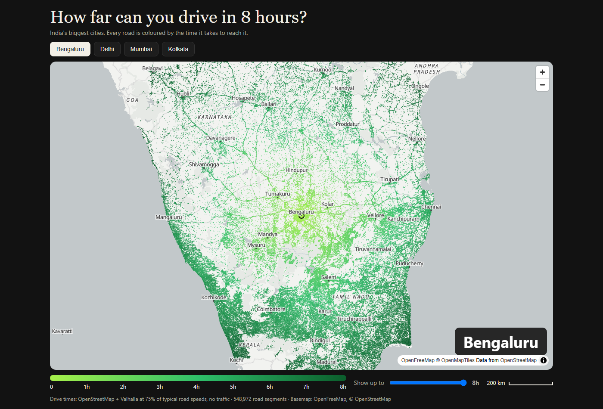
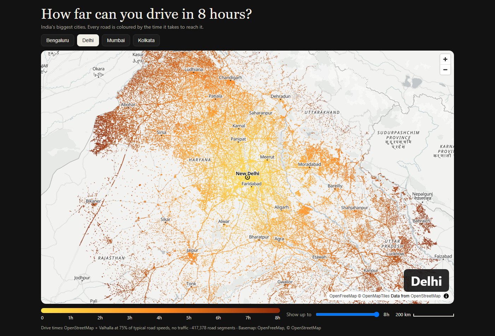
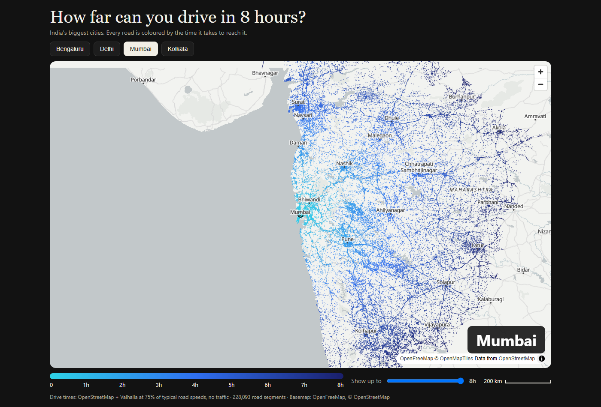

# How far can you drive in 8 hours? — India

Interactive map: every road reachable by car from a city within 8 hours, coloured by travel time.
Inspired by the OneMoreRoad.com maps. Live site: https://kayjey.github.io/How-far-can-you-drive-in-india/

## Screenshots

| Bengaluru | Delhi | Mumbai |
|---|---|---|
|  |  |  |

Every road is coloured by how long it takes to reach it by car (light = close, dark = about 8 hours). Same scale on every map.

## How it works
- Road data: OpenStreetMap (Geofabrik India extracts), filtered to motorway/trunk/primary/secondary/tertiary/unclassified.
- Drive times: [Valhalla](https://github.com/valhalla/valhalla) `/expansion` from the city centre, 8h budget.
  Times are scaled to 75% of free-flow speed (tolls, trucks, towns), no live traffic.
- `scripts/export.mjs` streams Valhalla's output into a compact binary (`public/data/<city>.bin`).
- `public/index.html` draws the roads on a canvas over an OpenFreeMap basemap with MapLibre GL JS. No build step.

## Regenerate a city
1. Build Valhalla tiles from the matching Geofabrik zone and run it on port 8802.
2. `node scripts/export.mjs bengaluru 0.75`

## Run locally
`python -m http.server 8810 --directory public` then open http://localhost:8810

Map data © OpenStreetMap contributors.
